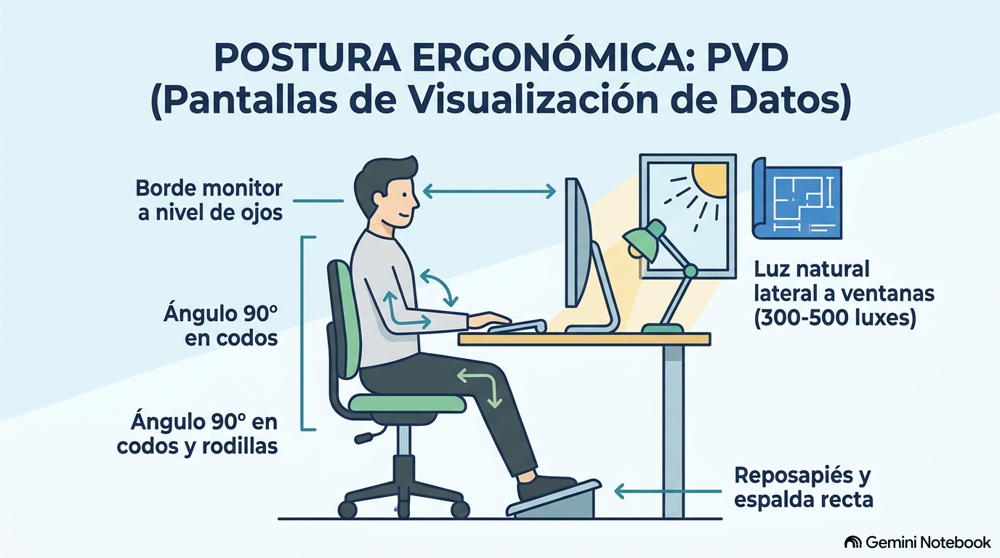
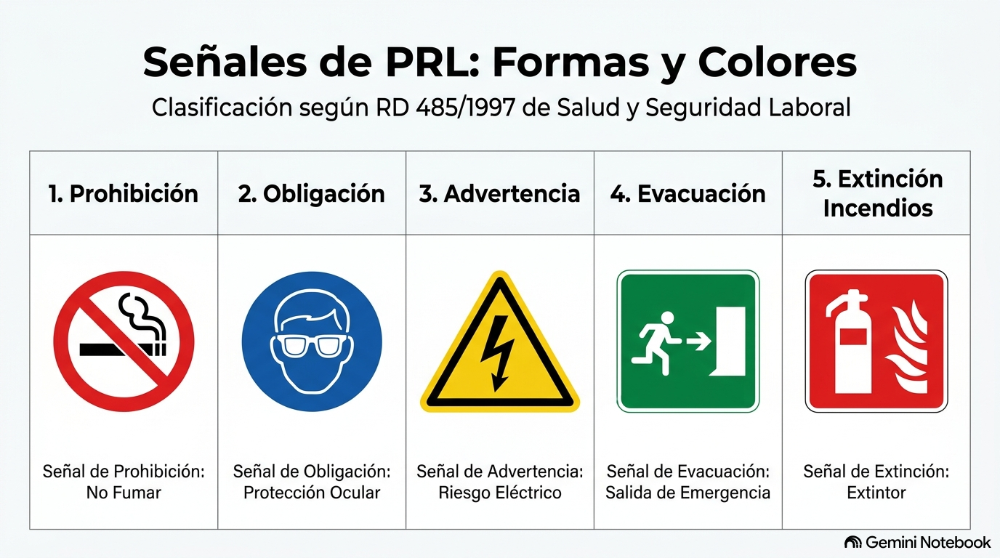

# Temario Completo y Resumen de Examen: IPE I Informática - U.D. 2 Salud Laboral

Este documento constituye una síntesis exhaustiva, actualizada y estructurada de todo el temario de la Unidad Didáctica 2 (**Salud Laboral**), integrando las anotaciones del documento oficial, los puntos destacados señalados por la profesora para el examen y las especificaciones técnicas de las normativas de prevención y guías del Instituto Nacional de Seguridad y Salud en el Trabajo (INSST).

---

## 1. Concepto de Salud, Marco Legal y Cobertura en FP (Pág. 5)

### Definición Oficial de la OMS
La **Organización Mundial de la Salud (OMS)** define la **salud** como:
> *"El estado de completo bienestar físico, psíquico y social, y no solo la ausencia de afecciones o enfermedades."*

### El Doble Carácter del Trabajo
El trabajo y la salud están estrechamente interrelacionados:
* **Factor de Bienestar:** Satisface necesidades económicas, fomenta el desarrollo personal y la integración social.
* **Factor de Riesgo:** Cuando las condiciones de trabajo son inadecuadas, se rompe el equilibrio físico, mental o social, provocando accidentes, enfermedades profesionales, fatiga o insatisfacción.

### Marco Legal y Normativa de Aplicación
* **Constitución Española (art. 40.2):** Encomienda a los poderes públicos velar por la seguridad e higiene en el trabajo.
* **Estatuto de los Trabajadores (art. 19):** Reconoce el derecho a la seguridad y la integridad física.
* **Ley 31/1995 de Prevención de Riesgos Laborales (LPRL):** Norma marco en España, modificada por la Ley 54/2003. Principios rectores: prevención, eficacia, coordinación, participación y responsabilidad.
* **Directiva Marco 89/391/CEE:** Base normativa de la Unión Europea.

### Cobertura del Alumnado de Formación Profesional (FFEOE)
* **Integración en la Seguridad Social:** El alumnado en período de Formación en Empresa (FFEOE) está obligatoriamente dado de alta y cotiza por contingencias comunes y profesionales (cobertura frente a Accidentes de Trabajo y Enfermedades Profesionales).
* **Gestión de la Cobertura:** La **Mutua de Accidentes de Trabajo** asociada a la empresa colaboradora es la encargada de prestar la asistencia médica y gestionar las prestaciones correspondientes ante cualquier siniestro.

---

## 2. Factores Físicos: El Ruido (RD 286/2006) y Confort Acústico (NTP 503) (Pág. 6 - 10)

### Concepto y Medición del Ruido
* **Definición:** Sonido no deseado o molesto cuya intensidad se mide en **decibelios (dB)**.
* **Ponderación Temporal:** El riesgo no depende solo del volumen, sino de la duración de la exposición. Se evalúa el nivel de ruido continuo equivalente ponderado para 8 horas ($L_{Aeq,8h}$).
* **Equipos de Medición Higiénica:**
  1. **Sonómetro:** Mide el nivel de ruido continuo en un punto o recinto determinado.
  2. **Dosímetro:** Registra la dosis acumulada o la presión acústica media soportada por un trabajador concreto a lo largo de su movilidad laboral.
  3. **Analizador de Impacto:** Mide los picos máximos de intensidad en ruidos impulsivos o de impacto.

### Doble Vertiente del Riesgo: Hipoacusia vs. Confort Acústico

| Criterio / Entorno | Entorno Industrial / CPD (Sala de Servidores) | Entorno de Oficina / Open Space (Desarrollo) |
| :--- | :--- | :--- |
| **Tipo de Riesgo** | **Riesgo Higiénico** (Riesgo de Enfermedad Profesional). | **Riesgo Ergonómico / Psicosocial** (Pérdida de confort). |
| **Daño a la Salud** | **Hipoacusia o sordera profesional** (destrucción irreversible de células ciliadas), acúfenos. | **Fatiga mental, falta de concentración, estrés, bugs/errores en código**. |
| **Normativa de Referencia** | **Real Decreto 286/2006** (Límites de ruido industrial). | **NTP 503 del INSST** (Confort acústico en oficinas). |
| **Indicador Práctico** | Necesidad de gritar a corta distancia para entenderse. | Dificultad para mantener la atención por tecleo, llamadas o hilo musical. |

### Cuadro de Valores Límite de Exposición al Ruido (RD 286/2006) (Pág. 10)

| Criterio de Exposición | Nivel Diario ($L_{Aeq,8h}$) | Nivel de Pico ($L_{Cpeak}$) | Medidas Preventivas Obligatorias para el Empresario |
| :--- | :--- | :--- | :--- |
| **Valor Inferior de Acción** | **80 dBA** | **135 dBC** | • Entrega obligatoria de protectores auditivos (uso voluntario por el trabajador).<br>• Evaluación de riesgos cada 3 años.<br>• Control audiométrico preventivo cada 5 años.<br>• Información y formación al trabajador. |
| **Valor Superior de Acción** | **85 dBA** | **137 dBC** | • **Entrega y USO OBLIGATORIO** de protectores auditivos (EPI).<br>• Evaluación de riesgos anual.<br>• Control audiométrico periódico cada 3 años.<br>• Señalización obligatoria de la zona ruidosa.<br>• Plan de medidas técnicas y organizativas de reducción. |
| **Valor Límite Infranqueable** | **87 dBA** | **140 dBC** | • **Límite máximo absoluto en el oído** (teniendo en cuenta la atenuación del EPI).<br>• Adopción inmediata de medidas correctoras para reducir la exposición. |

### Criterios Técnicos de Confort Acústico en Oficinas (NTP 503 del INSST)
* **Nivel General Recomendado en Oficinas:** Debe mantenerse en el rango de **40 a 45 dBA**.
* **Umbral de Quejas y Disconfort:** A partir de los **50 dBA** aumentan significativamente las quejas por falta de concentración y estrés.
* **Climatización y Ventilación:** Los sistemas HVAC en zonas de alta concentración mental deben generar un ruido por debajo de los **35 dBA** (idealmente **< 30 dBA**).
* **Priorización de Medidas Correctoras (NTP 503):**
  1. *Sobre la Fuente:* Aislar servidores, instalar extractores silenciosos o sustituir teclados mecánicos ruidosos por modelos de membrana/silenciosos.
  2. *Sobre el Medio Difusor:* Colocar paneles fonoabsorbentes, mamparas acústicas divisoras y falsos techos para reducir el tiempo de reverberación.
  3. *Sobre el Receptor:* Reorganizar la distribución del espacio separando físicamente las áreas de soporte telefónico de las zonas de desarrollo y silencio.

---

## 3. Factores Físicos: Vibraciones (RD 1311/2005) (Pág. 11)

### Clasificación según Frecuencia y Daños a la Salud
El riesgo derivado de las vibraciones depende de su frecuencia y de la vía de transmisión al organismo:

```
Vibraciones Físicas (RD 1311/2005)
├── Muy Baja Frecuencia (< 2 Hz)  ──> Balanceo de barcos, trenes, aviones  ──> Mareos y vértigo
├── Baja Frecuencia (2 - 20 Hz)    ──> Transporte urbano, grúas, camiones ──> Lumbalgias, hernias discales
└── Alta Frecuencia (> 20 Hz)      ──> Martillos rompedores, pulidoras   ──> Lesiones en articulaciones y huesos
```

* **Vibraciones Mano-Brazo:** Transmitidas por herramientas manuales. Provocan la **enfermedad de Raynaud** (síndrome del dedo blanco), osteonecrosis del escafoides y artrosis del codo. (Valor de acción: $2,5 \, m/s^2$).
* **Vibraciones Cuerpo Entero:** Transmitidas a través del asiento o plataforma en vehículos industriales. Producen afecciones en la columna vertebral (discopatías, ciática) y trastornos digestivos. (Valor de acción: $0,5 \, m/s^2$).

---

## 4. Factores Físicos: Iluminación y Ergonomía PVD (RD 486/1997 y Guía INSST) (Pág. 12 - 14)

### Principios de Iluminación y Mantenimiento (Pág. 12)
* **Prioridad Normativa:** Se debe priorizar la **iluminación natural**. La artificial general actuará como complemento y la localizada se reservará para tareas de exigencia visual muy elevada.
* **Efecto Estroboscópico (Parpadeo):** El parpadeo de luminarias defectuosas provoca fatiga ocular e **ilusiones ópticas** (puede hacer parecer que los ventiladores de refrigeración de un servidor en un CPD están parados o giran despacio), incrementando el riesgo de atrapamientos o cortes.
* **Alumbrado de Emergencia:** Obligatorio en áreas donde la falla de luz general suponga un riesgo. Garantiza la evacuación segura y permite el apagado controlado de servidores y cuadros eléctricos.

### Niveles Mínimos Obligatorios en Luxes (RD 486/1997 - Pág. 13)

| Exigencia Visual de la Tarea | Nivel Mínimo Legal (Luxes) | Aplicación en el Sector Informático y Oficinas |
| :--- | :--- | :--- |
| **Bajas exigencias visuales** | **100 lux** | Almacenes de hardware, cuartos de mantenimiento. |
| **Exigencias visuales moderadas** | **200 lux** | Tareas de montaje sencillo, recepción. |
| **Exigencias visuales altas** | **500 lux** | **Oficinas, programación, trabajo continuado con PVD, lectura**. |
| **Exigencias visuales muy altas** | **1.000 lux** | Reparación de microelectrónica, soldadura de placas base. |
| **Trabajos de precisión** | **5.000 lux** | Inspección de circuitos ópticos o componentes de microchip. |
| **Vías de circulación (uso habitual)**| **50 lux** | Pasillos y zonas de tránsito en oficinas. |

* **Duplicación de Luxes:** Los niveles mínimos se duplicarán si existen riesgos apreciables de caída, si un error visual genera peligro grave o si el contraste entre el objeto y el fondo es muy débil.

### Ergonomía del Puesto con Pantallas de Visualización de Datos (PVD) (Pág. 14 & Guía INSST)


* **Riesgo por Exceso de Luz:** Un nivel lumínico excesivo destruye el contraste del monitor y genera reflejos secundarios, provocando **fatiga visual (astenopia)** y cefaleas.
* **Ubicación y Orientación de la Pantalla:** Los monitores y escritorios deben colocarse **perpendiculares a las ventanas** (luz lateral). Nunca de frente ni de espaldas a la luz natural. Fluorescentes equipados con difusores o rejillas.
* **Criterios Ergonómicos Elementales del Puesto de PVD:**
  * **Distancia Ojo-Pantalla:** Mínimo **40 cm** (recomendado 50–70 cm).
  * **Altura del Monitor:** El borde superior de la pantalla debe estar a la altura de los ojos o ligeramente por debajo. Ángulo de visión comprendido entre la horizontal y los **60°** hacia abajo.
  * **Superficie de la Pantalla:** Acabado mate antirreflejo.
  * **Atril Regulable:** Recomendado para colocar documentos a la misma altura y distancia que la pantalla, evitando la fatiga de acomodación visual y los giros de cuello.
  * **Reposapiés:** Superficie antideslizante con inclinación ajustable entre **0° y 15°**.
  * **Teclado:** Independiente e inclinable, con espacio delantero para apoyar muñecas y antebrazos.
  * **Ratón:** Adaptado a la curvatura de la mano y situado próximo al teclado.
  * **Silla de Trabajo:** Estable (5 apoyos con ruedas), regulable en altura y profundidad, con apoyo lumbar y bordes redondeados.
  * **Pausas y Salud:** Organizar pausas de **10 a 15 minutos cada 1 a 2 horas** de trabajo continuado e integrar reconocimientos oftalmológicos periódicos.

---

## 5. Condiciones Termohigrométricas: Temperatura y Humedad (Pág. 16)

Según el Anexo III del Real Decreto 486/1997:
* **Locales de Trabajo Sedentarios (Oficinas / Informática):** La temperatura debe mantenerse entre **17 ºC y 27 ºC**.
* **Locales de Trabajo Ligeros:** La temperatura debe situarse entre **14 ºC y 25 ºC**.
* **Humedad Relativa del Aire:** Comprenderá entre el **30% y el 70%**.
  * *Especificidad Técnica en Tecnología:* En salas donde exista riesgo de **electricidad estática** (como Salas de Servidores o CPDs), el límite inferior obligatorio de humedad es del **50%**.

---

## 6. Factores de Riesgo Químicos (Pág. 18)

### Vías de Entrada de Agentes Químicos
1. **Respiratoria (Inhalación):** Vía principal de entrada (polvos, humos, gases, vapores).
2. **Digestiva (Ingestión):** Por hábitos antihigiénicos (comer, beber o fumar en el puesto).
3. **Cutánea (Piel):** Absorción directa a través de la epidermis.
4. **Parenteral:** Entrada directa por cortes, punciones o heridas abiertas.

### Clasificación según el Tipo de Intoxicación
* **Intoxicación Aguda:** Reacción patológica inmediata tras una exposición intensa o accidental a una dosis elevada.
* **Intoxicación Crónica:** Deterioro progresivo a largo plazo por exposiciones repetidas a bajas dosis, derivando en **Enfermedad Profesional**.

---

## 7. Daños Derivados del Trabajo y Accidente de Trabajo (Pág. 21 - 23)

### Concepto Legal de Accidente de Trabajo (AT) (Pág. 21)
Se entiende por **Accidente de Trabajo** toda lesión corporal que el trabajador sufra con ocasión o como consecuencia del trabajo ejecutado por cuenta ajena.

### Requisitos Legales Esenciales
1. **Lesión Corporal:** Daño físico o psíquico directo.
2. **Relación de Causalidad:** Nexo directo causa-efecto entre la actividad laboral y el daño.
3. **Presunción Legal:** Las lesiones producidas en el tiempo y lugar de trabajo se presumen accidentes laborales salvo prueba en contrario.

### Clasificación de Casos y Supuestos Legales (Pág. 22 - 23)

```
                            ¿ES ACCIDENTE DE TRABAJO (AT)?
                                          │
       ┌──────────────────────────────────┴──────────────────────────────────┐
       ▼                                                                     ▼
   INCLUIDOS COMO AT (SÍ)                                          EXCLUIDOS DE AT (NO)
  ├── In itinere (sin interrupción personal)                     ├── Fuerza mayor extraña al trabajo
  ├── In misión (trayectos por orden de empresa)                 ├── Dolo (mala fe voluntaria)
  ├── Imprudencia profesional (confianza/rutina)                 └── Imprudencia temeraria (desobediencia grave)
  ├── Tareas distintas por orden de la empresa
  └── Actos de salvamento ligados al trabajo
```

* **Accidente *In Itinere*:** Sucede al ir o volver del trabajo. Requiere 4 elementos: teleológico (motivo laboral), cronológico (tiempo habitual), topográfico (ruta lógica sin paradas personales) e idóneo (transporte adecuado).
* **Accidente *In Misión*:** Ocurre durante un desplazamiento ordenado por la empresa dentro de la jornada para cumplir un cometido profesional (ej. acudir a reparar un servidor a una sucursal).
* **Imprudencia Profesional (SÍ es AT):** Derivada del exceso de confianza o la rutina en el trabajo.
* **Imprudencia Temeraria (NO es AT):** Manifiesto desprecio del riesgo y desobediencia explícita a las normas de seguridad.

---

## 8. Factores Organizativos y Psicosociales (Pág. 24 - 25)

* **Fatiga Mental:** Disminución temporal de la capacidad cognitiva por sobrecarga de procesamiento de datos.
* **Estrés Laboral:** Tensión física y psíquica producida por el desequilibrio entre las exigencias del puesto y los recursos del trabajador.
* **Síndrome del Quemado (*Burnout*):** Agotamiento emocional y profesional profundo tras un estrés crónico no resuelto.
* **Acoso Moral (*Mobbing*):** Violencia psicológica sistemática y prolongada en el entorno laboral.
* **Insatisfacción Laboral:** Respuesta afectiva negativa surgida del choque entre las expectativas profesionales y la realidad de la tarea.

---

## 9. Técnicas de Prevención de Riesgos Laborales (Pág. 27)

| Disciplina Preventiva | Ámbito de Actuación | Objetivo Técnico Principal |
| :--- | :--- | :--- |
| **Seguridad en el Trabajo** | Instalaciones, máquinas, herramientas y estructuras. | Evitar los **Accidentes de Trabajo**. |
| **Higiene Industrial** | Agentes contaminantes (físicos, químicos y biológicos). | Evitar las **Enfermedades Profesionales**. |
| **Ergonomía y Psicosociología** | Adaptación del puesto, carga física/mental, diseño de interfaz. | Evitar la **fatiga, el estrés y la insatisfacción**. |
| **Medicina del Trabajo** | Vigilancia de la salud corporal y reconocimientos médicos. | Prevención, diagnóstico precoz y curación. |

---

## 10. Medidas de Prevención y Protección (RD 486/1997 & Guía INSST) (Pág. 32)

* **Medidas de Prevención:** Actúan sobre el origen del riesgo para eliminarlo o reducirlo antes de que se produzca el daño.
* **Medidas de Protección:** Actúan cuando el riesgo no se ha podido eliminar, minimizando sus consecuencias.
  1. **Protección Colectiva (PRIORITARIA):** Protege a un grupo de trabajadores (barandillas, redes, interruptores diferenciales, extracciones de aire).
  2. **Protección Individual (EPI - SECUNDARIA):** Llevados de forma personal por el trabajador (casco, gafas, tapones auditivos).

### Clasificación Oficial de los Equipos de Protección Individual (EPIs)
* **Categoría I:** Diseño sencillo; protegen contra riesgos mínimos (ej. guantes de jardinería o limpieza).
* **Categoría II:** Diseño de complejidad media; protección intermedia (ej. cascos de seguridad, calzado de protección).
* **Categoría III:** Diseño complejo; protegen frente a **riesgos mortales o de daños irreversibles** (ej. arneses anticaída, EPIs contra gases tóxicos o alta tensión).

---

## 11. Especificaciones de los Lugares de Trabajo y Equipos (Pág. 33 - 34)

Según el Real Decreto 486/1997:
* **Dimensiones Mínimas de los Espacios de Trabajo:**
  * **Altura desde el suelo al techo:** Mínimo **3 metros** (reducible a **2,5 metros** en oficinas, comercios y despachos).
  * **Superficie libre por trabajador:** Mínimo **2 $m^2$**.
  * **Volumen no ocupado por trabajador:** Mínimo **10 $m^3$**.
* **Anchura Mínima de Pasos y Puertas (Pág. 34):**
  * **Puertas exteriores:** Mínimo **80 cm** de anchura.
  * **Pasillos:** Mínimo **1 metro** de anchura.
* **Máquinas y Herramientas (Pág. 34):**
  * Adquisición obligatoria de equipos con **Marcado CE**.
  * Las máquinas anteriores a 1995 que carezcan del marcado CE deben estar puestas en conformidad según el **RD 1215/1997** e inspeccionadas periódicamente.

---

## 12. Señalización en Prevención de Riesgos (RD 485/1997) (Pág. 38)



La señalización es una técnica complementaria que no elimina el riesgo por sí misma. Se clasifica por formas y colores según el Anexo II del RD 485/1997:

| Tipo de Señal | Forma Geometrica | Color de Fondo / Borde | Pictograma | Significado y Ejemplo |
| :--- | :--- | :--- | :--- | :--- |
| **Prohibición** | Redonda | Borde y banda roja, fondo blanco | Negro | Prohíbe acciones peligrosas (ej. *Prohibido el paso*). |
| **Obligación** | Redonda | Fondo azul | Blanco | Obliga a usar EPI o actuar (ej. *Uso obligatorio de casco/protección auditiva*). |
| **Advertencia** | Triangular | Fondo amarillo, borde negro | Negro | Advierte de un riesgo (ej. *Peligro ruido*, *Riesgo eléctrico*). |
| **Salvamento / Evacuación** | Cuadrada / Rectangular | Fondo verde | Blanco | Señala salidas de emergencia o primeros auxilios. |
| **Lucha contra Incendios** | Cuadrada / Rectangular | Fondo rojo | Blanco | Ubicación de extintores y mangueras. |

---

## 13. Gestión y Modalidades de la Prevención en la Empresa (Pág. 27 & LPRL)

### Modalidades de Organización Preventiva
1. **Asunción personal por el empresario:** Posible en empresas de hasta 10 trabajadores (o hasta 25 con un solo centro) si el empresario desarrolla habitualmente su actividad en el centro y las actividades no son de elevado riesgo.
2. **Designación de trabajadores:** El empresario designa uno o varios trabajadores formados para gestionar la prevención.
3. **Servicio de Prevención Propio (SPP):** Obligatorio en empresas de más de 500 trabajadores (o entre 250 y 500 si realizan actividades de alto riesgo).
4. **Servicio de Prevención Ajeno (SPA):** Contratación de una entidad especializada acreditada.

### Colectivos Especialmente Sensibles
La LPRL obliga a adoptar medidas preventivas específicas y personalizadas para:
* Trabajadores con discapacidades o patologías previas.
* Trabajadoras embarazadas o en período de lactancia.
* Trabajadores menores de edad (menores de 18 años).
* Trabajadores temporales o de Empresas de Trabajo Temporal (ETT).
